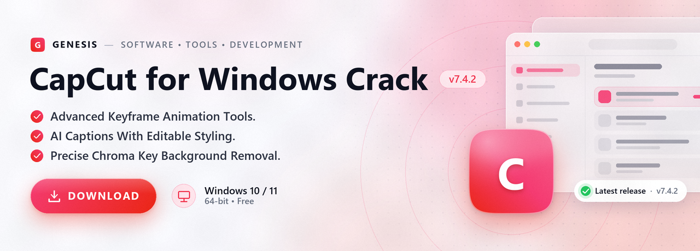

# Capcut For Windows - Windows 10 & 11

## Introduction

Capcut For Windows is a video editing software designed specifically for Windows 10 and Windows 11 users. It addresses the need for an accessible, powerful video editing solution that allows users to create and edit videos easily, without requiring extensive technical expertise. Whether you're a content creator, a social media enthusiast, or someone looking to make personal videos, Capcut simplifies the editing process with its user-friendly interface.

Users can expect a range of practical capabilities that include trimming, merging, and adding effects to videos. The software aims to provide tools that enhance creativity and streamline the video production process, making it easier to produce high-quality content suitable for various platforms.

---

## System Requirements

| Requirement            | Details                                |
|-----------------------|----------------------------------------|
| Supported OS          | Windows 10, Windows 11                |
| Architecture          | x64                                    |
| Processor             | Not specified                          |
| RAM                   | Not specified                          |
| Storage               | Not specified                          |
| Permissions           | Not specified                          |
| Internet Connection    | Not specified                          |
| Dependencies          | Not specified                          |

---

## Features

- **User-Friendly Interface**: Capcut For Windows features an intuitive layout that makes it easy for anyone to navigate, regardless of their level of video editing experience.

- **Video Trimming and Merging**: Users can effortlessly trim clips and merge multiple video segments to create cohesive stories.

- **Rich Effects Library**: The software includes a variety of visual and audio effects, enhancing the overall quality and creativity of the videos.

- **Text and Title Customization**: Users can add customizable text overlays and titles to their videos, allowing for personalized branding and messaging.

- **Music and Sound Effects Integration**: Easily incorporate background music and sound effects to enhance the audio experience of your videos.

- **High-Quality Exports**: Capcut enables users to export their finished videos in various resolutions, ensuring compatibility with different platforms.

- **Easy Sharing Options**: The software provides straightforward options to share videos directly to social media platforms, streamlining the publishing process.

- **Regular Updates**: Users can expect occasional updates that introduce new features, effects, and improvements based on user feedback.

- **Multi-Language Support**: Capcut For Windows accommodates a diverse user base with support for multiple languages, making it accessible for non-English speakers.

- **Tutorials and Guides**: The software includes helpful resources and tutorials that assist users in understanding how to fully utilize its features.

---

## How It Works

1. **Installation**: Download and install Capcut For Windows by following the setup instructions provided. Ensure your system meets the required specifications.

2. **Project Creation**: Launch the application and create a new project. Import video clips and media files that you want to edit.

3. **Editing**: Use the various tools available within the interface to trim, merge, add effects, and customize your video content as desired.

4. **Exporting and Sharing**: Once your video is complete, export it in your preferred format and resolution. You can then share it directly to social media platforms or save it to your device.

---

## Compatibility

**Operating Systems and Architecture**  
Capcut For Windows is compatible with Windows 10 and Windows 11 operating systems, specifically designed for x64 architecture.

**Hardware Requirements**  
Specific hardware requirements such as processor speed and RAM are not explicitly mentioned in the available documentation.

**Runtime Dependencies**  
No additional runtime dependencies have been specified for the software.

**Limitations and Notes**  
While the software is designed for desktop environments, further information regarding limitations or specific incompatibilities is not provided.

---

## FAQ

### What is Capcut For Windows used for?
Capcut For Windows is a video editing application that allows users to create and edit videos with ease. It is particularly beneficial for content creators, social media influencers, and anyone looking to produce engaging video content without complex software.

### How do I install Capcut For Windows?
To install Capcut For Windows, download the installation file from the designated source. Once downloaded, run the setup file and follow the on-screen instructions to complete the installation process.

### Is Capcut For Windows compatible with my system?
Capcut For Windows is compatible with both Windows 10 and Windows 11 operating systems. Ensure you are using an x64 architecture for optimal performance.

### Can I share my videos directly from Capcut?
Yes, Capcut For Windows provides options to share your edited videos directly to various social media platforms, making it easy to publish your content.

### What should I do if I encounter issues with the software?
If you experience any issues, refer to the built-in tutorials or user guides for troubleshooting tips. Additionally, checking online forums or community discussions can provide insights and solutions from other users.

---

## Disclaimer

Details regarding Capcut For Windows can vary based on the version and system configuration. Users are advised to back up important data before making significant changes or installations.

---

## License

The specific software license for Capcut For Windows is not provided in the available documentation. Users should consult the license included with the software or refer to the official terms from the vendor for more information.
